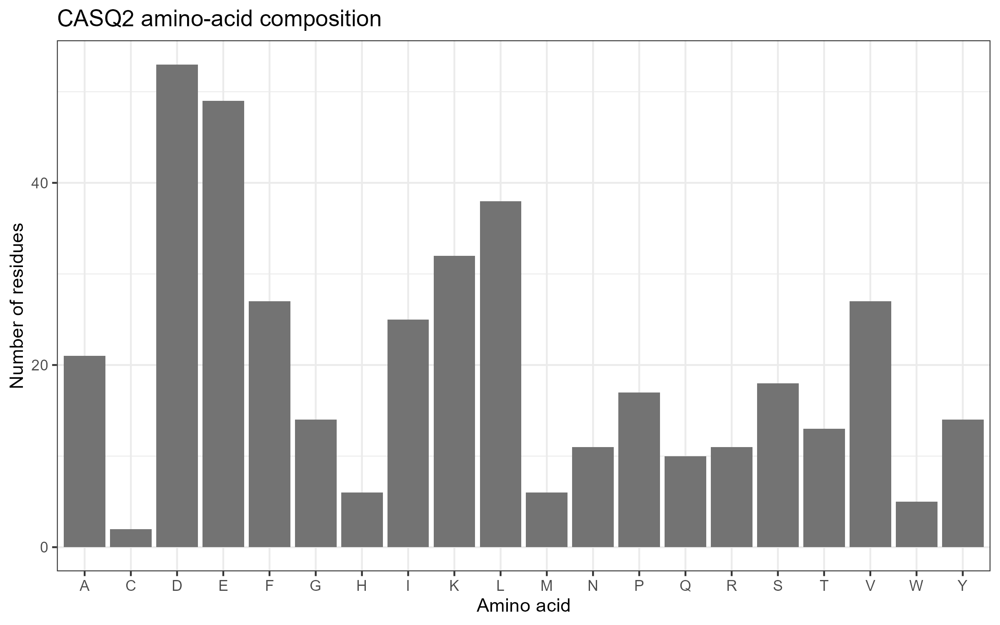
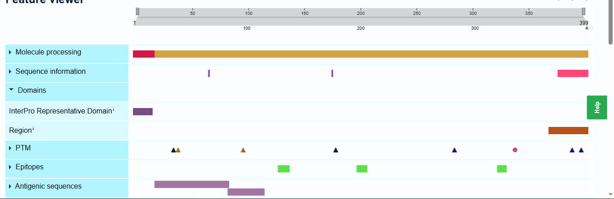

# Muscle-Contractility-CASQ2

Individual laboratory assignment: Molecular Mechanisms of Muscle Contractility (Cell and Molecular Biology)

## (a) Assignment
- **Assignment number:** 28
- **Gene:** CASQ2 (calsequestrin 2), *Homo sapiens*
- **Transcript:** NM_001232.4
- **Variant:** c.339_354del (p.Ser113fs)
- **ClinVar Variation ID:** 17611
- **NCBI Gene ID:** 845
- **Protein accession (NP_):** NP_001223.2

## (b) Research question
How does the frameshift deletion CASQ2 c.339_354del (p.Ser113fs) relate to the normal role of calsequestrin-2 in cardiac calcium storage, and how strong is the evidence that it disrupts muscle function?

## (c) Methods
Software: R [cat(readLines("results/gene_summary.txt"), sep = "\n")
cat(readLines("results/protein_accession.txt"), sep = "\n")
cat("Protein length:", protein_length, "\n")
cat("Residue 113:", aa[113], "\n")
print(head(results[order(-results$Count), ], 3))
R.version.string, from `R.version.string`] with packages rentrez and ggplot2. All code is in `analysis.R`.

1. Created the project folder `Muscle_Contractility_CASQ2` with `data`, `results`, and `figures` subfolders, and set the four assignment variables (`gene_symbol`, `transcript_accession`, `clinvar_id`, `variant_protein`).
2. Searched NCBI Gene with `entrez_search(db = "gene", term = "CASQ2[Gene Name] AND txid9606[Organism]")`, confirmed the exact symbol with `entrez_summary()`, and saved `results/gene_summary.txt`.
3. Fetched the GenBank record of NM_001232.4 with `entrez_fetch(db = "nuccore", rettype = "gb")`, extracted the NP_ accession with a regular expression, and saved `results/protein_accession.txt`.
4. Fetched the protein FASTA with `entrez_fetch(db = "protein", rettype = "fasta")` and saved `data/CASQ2_protein.fasta`.
5. Counted the 20 standard amino acids, saved `results/amino_acid_composition.csv`, and plotted `figures/01_amino_acid_composition.png` with ggplot2.
6. Checked that residue 113 of the retrieved protein is serine, to confirm the numbering matches the variant.
7. Reviewed ClinVar record 17611 manually on 27 Oct 2026 (section e).
8. Plotted the affected position on the reference protein as `figures/02_variant_position.png`.
9. Saved an annotated UniProt Feature viewer image (O14958) as `figures/protein_structure_or_splice_diagram.png`.

**To rerun with a fresh R installation:** install R and RStudio, open the project folder, run `install.packages(c("rentrez", "ggplot2"))` once, then run `analysis.R` from top to bottom. An internet connection is needed for NCBI queries.

**Errors corrected:**
1. When creating the project folder in Command Prompt, my first command block was pasted as a single line without line breaks, which gave "The system cannot find the path specified." I reran the commands one at a time. Because `Documents` was not the right location on my computer, I created the project in my user folder instead (`C:\Users\tacan\Muscle_Contractility_CASQ2`) and confirmed the contents with `dir`.
2. The folder was not in Documents or Quick access in File Explorer, so I located it by pasting its full path into the File Explorer address bar.
 
## (d) Results

- Gene: calsequestrin 2, chromosome 1 (Specifically at location 1p13.1)
- NCBI Gene ID: 845
- Protein: NP_001223.2, 399 amino acids
- Residue 113 check: residue 113 is S (serine), as expected for p.Ser113fs
- UniProt cross-check: reviewed entry O14958 (CASQ2_HUMAN) is 399 aa. Matches (both are exactly 399 amino acids).
- Three most abundant amino acids: Aspartate (D) 53, Glutamate (E) 49, Leucine (L) 38

### Figure 1. Amino-acid composition

### Figure 2. Variant position

Numeric position: residue 113 of 399 amino acids. The marker shows a sequence location only. It does not show a shortened protein or prove an altered interaction.

### Figure 3. UniProt feature map

*UniProt O14958 (CASQ2_HUMAN) Feature viewer, accessed 27 Oct 2026. UniProt annotates a signal peptide (1-19, by similarity), the mature chain (20-399), and a C-terminal compositional bias for acidic residues (373-399, automatic annotation). Residue 113, where p.Ser113fs begins, lies within the mature chain and outside these annotated regions.*

## (e) Variant interpretation (ClinVar, accessed 27 Oct 2026)

| Field | Value |
|---|---|
| Link | https://www.ncbi.nlm.nih.gov/clinvar/variation/17611/ |
| Variation ID / accession | 17611 / VCV000017611.14 |
| Variant name | NM_001232.4(CASQ2):c.339_354del (p.Ser113fs) |
| Transcript and HGVS | NM_001232.4:c.339_354del (MANE Select); protein NP_001223.2:p.Ser113fs |
| Variant type | Deletion, 16 bp; molecular consequence: frameshift |
| Genomic location | 1p13.1; GRCh38 chr1:115740794-115740809 |
| Conditions listed | CPVT 1, CPVT 2, "cardiovascular phenotype," "not provided" |
| Aggregate classification | Pathogenic (4 of 5 submissions contributing) |
| Review status | criteria provided, multiple submitters, no conflicts (2 stars) |
| Last evaluated | 5 May 2026 |
| Supporting publications | di Barletta et al. 2006, *Circulation* (PMID 16908766); Ng et al. 2020, *Circulation* (PMID 32693635); Postma et al. 2002, *Circulation Research* (PMID 12386154) |
| Date accessed | 27 Oct 2026 |

**What the sequence change does.** The variant deletes 16 nucleotides (c.339_354) in exon 3 of CASQ2. Because 16 is not a multiple of 3, the reading frame shifts after codon 113. One submitter (Labcorp) gives the full protein change as p.Ser113Argfs*6, a premature stop codon about five residues downstream. This is a frameshift, not a missense, stop-gain, or in-frame change. A transcript with a premature stop this early is expected to be degraded by nonsense-mediated decay (NMD), so little or no CASQ2 protein would be made. That is a prediction. I did not find evidence in this record that a truncated protein is present in patient tissue, so I do not describe one as confirmed.

**Findings from the record**
1. **Notation differs between sources, but it is the same variant.** ClinVar lists NM_001232.4 and the older NM_001232.3. The protein change appears as p.Ser113fs (ClinVar and the assignment), p.Ser113Argfs*6 (Labcorp), and G112+5X (older literature name). I kept the assigned notation.

2. **Condition labels are inconsistent.** Submitters list CPVT 1, CPVT 2, "cardiovascular phenotype," or "not provided." I recorded this without resolving it.

3. **No classification conflict.** All five submissions are Pathogenic and the aggregate is Pathogenic. The OMIM entry (2006) does not contribute to the aggregate. This reflects the record on the access date, and classifications can change.

4. **Functional evidence is limited.** The main experimental study is di Barletta 2006, in which the mutant was expressed in rat cardiac myocytes. Per the OMIM entry for it, the mutant did not bind calcium, cells had lower sarcoplasmic reticulum calcium content, and delayed afterdepolarizations appeared after isoproterenol. Most other submissions rely on clinical testing and the expected effect of loss-of-function variants.

5. **Inheritance caveat.** ClinGen lists CASQ2 as associated with an autosomal recessive phenotype. Reported cases involve the deletion in the homozygous state or together with a second CASQ2 variant. The OMIM comment states that heterozygous carriers in the original family had no ventricular arrhythmias.

## (f) Limitations and validation experiment
**Limitations**
- The functional data come from an expressed mutant protein in rat myocytes, not from human patient heart tissue.
- NMD is expected but was not demonstrated for this transcript in the records I reviewed.
- The evidence is mostly clinical and predictive, and ClinVar can change after 27 Oct 2026.
- Because the disease is mainly recessive, the Pathogenic label does not apply equally to heterozygous carriers.
- The UniProt signal peptide is annotated by similarity, and the acidic-residue region is an automatic annotation.
- Amino-acid composition cannot show function, so it was not used to support the mechanism.

**Proposed experiment.** Generate cardiomyocytes from patient-derived or gene-edited iPSCs carrying the deletion (homozygous), with isogenic corrected controls. (1) Use RT-qPCR with and without an NMD inhibitor (such as cycloheximide) to test whether CASQ2 mRNA is degraded, and western blot to look for any truncated protein. (2) Use calcium imaging (for example Fluo-4) before and after isoproterenol to measure sarcoplasmic reticulum calcium content, spontaneous calcium release events, and delayed afterdepolarizations. If the proposed mechanism is correct, mutant cells should show lost or strongly reduced CASQ2 protein and more spontaneous release under adrenergic stress, and correcting the deletion should reverse this.

## (g) References and links (all accessed 27 Oct 2026 unless noted)
- NCBI Gene: https://www.ncbi.nlm.nih.gov/gene/845
- NCBI Nucleotide NM_001232.4: https://www.ncbi.nlm.nih.gov/nuccore/NM_001232.4
- NCBI Protein: https://www.ncbi.nlm.nih.gov/protein/NP_001223.2
- ClinVar 17611: https://www.ncbi.nlm.nih.gov/clinvar/variation/17611/
- UniProt O14958 (CASQ2_HUMAN): https://www.uniprot.org/uniprotkb/O14958
- di Barletta MR et al. Clinical phenotype and functional characterization of CASQ2 mutations associated with catecholaminergic polymorphic ventricular tachycardia. *Circulation* 2006;114:1012-1019. PMID 16908766.
- Postma AV et al. Absence of calsequestrin 2 causes severe forms of catecholaminergic polymorphic ventricular tachycardia. *Circ Res* 2002. PMID 12386154.
- Ng K et al. An international multicenter evaluation of inheritance patterns, arrhythmic risks, and underlying mechanisms of CASQ2-catecholaminergic polymorphic ventricular tachycardia. *Circulation* 2020. PMID 32693635.

## Answers to the six questions
1. **What does CASQ2 encode?** CASQ2 encodes calsequestrin-2, a calcium-binding protein in the sarcoplasmic reticulum (SR) of cardiac muscle. It stores calcium in the SR near the ryanodine receptor (RyR2), which releases calcium to trigger contraction, and it is thought to buffer that calcium and influence RyR2 opening. According to the UniProt Function section, calsequestrin-2 acts as a high-capacity, moderate-affinity internal calcium store that binds Ca²⁺ ions through clusters of acidic residues, and it regulates the release of lumenal Ca²⁺ via RYR2 to trigger muscle contraction. It does not drive the actin-myosin cycle itself. It supports contraction and relaxation by controlling the calcium supply.

2. **Accession and length:** NP_001223.2 and 399 amino acids, retrieved with R from NM_001232.4.

3. **Composition chart:** The three most abundant residues are Asp (D) 53, Glu (E) 49, and Leu (L) 38, so the two acidic residues, Asp and Glu, are the most abundant in the protein. UniProt annotates an acidic stretch at residues 373-399, which fits the idea of a calcium-binding protein, but that is context from UniProt and not a result from the chart. The chart cannot show function, domain organization, calcium-binding sites, or the effect of the variant. It only counts residues.

4. **ClinVar variant and classification:**  c.339_354del (p.Ser113fs), Pathogenic in the aggregate (4 of 5 submissions contributing), review status criteria provided, multiple submitters, no conflicts (2 stars), last evaluated 5 May 2026. Evidence is mainly clinical testing, plus one functional study (di Barletta 2006).

5. **Mechanism and uncertainty:** the supported mechanism is loss of CASQ2 function, leading to reduced SR calcium storage and abnormal calcium release in stressed cardiomyocytes, which is associated with CPVT. Uncertain: whether any truncated protein is made in patients, how completely NMD removes the mRNA, and why heterozygous carriers are usually unaffected.

6. **Additional experiment:** the iPSC-cardiomyocyte experiment in section (f).

## Discussion
**Experimentally observed.** In the main functional study (di Barletta 2006), a CASQ2 mutant carrying the 16-bp deletion, expressed in rat cardiac myocytes, did not bind calcium. The cells stored less calcium in the SR and showed smaller calcium release signals, and after isoproterenol they developed delayed afterdepolarizations, which are abnormal electrical events that can trigger arrhythmia. These are laboratory observations in an expressed protein, not measurements in human heart tissue.

**Clinical association.** ClinVar classifies the variant as Pathogenic, with five submissions in agreement. Submitters describe patients with CPVT who carry the deletion in both copies of the gene or together with a second CASQ2 variant. The OMIM comment on the original family reports that heterozygous carriers had no ventricular arrhythmias. The clinical link is therefore strongest for biallelic carriers, consistent with ClinGen's autosomal recessive annotation of the gene.

**Predicted.** Deleting 16 bases shifts the reading frame at codon 113 and creates a premature stop codon about five residues later (p.Ser113Argfs*6, as written by one submitter). This is predicted to trigger NMD, so little or no CASQ2 protein would be made. Any truncated product would lack the rest of the mature protein, including the acidic C-terminal region annotated by UniProt. These are predictions from the sequence change. I did not find direct evidence in the ClinVar record that a truncated protein is detected in patients.

**Causal chain.** CASQ2 gene → calsequestrin-2, which stores calcium in the cardiac SR near RyR2 → c.339_354del shifts the reading frame and likely removes the protein → less SR calcium storage and altered RyR2 regulation → spontaneous calcium release and delayed afterdepolarizations under adrenergic stress → arrhythmia (CPVT).

**Limits.** The functional evidence is small and comes from an expressed protein in rat cells. ClinVar condition labels are inconsistent, and the classification reflects the record on 27 Oct 2026. The experiment in section (f) would directly test whether the mRNA and protein are lost and whether calcium handling is abnormal in human cardiomyocytes.
